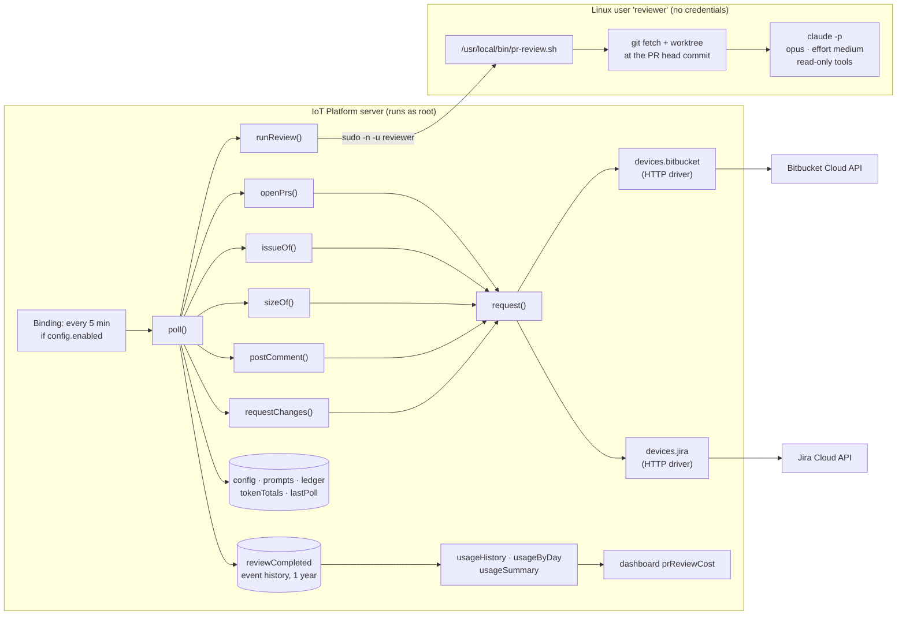
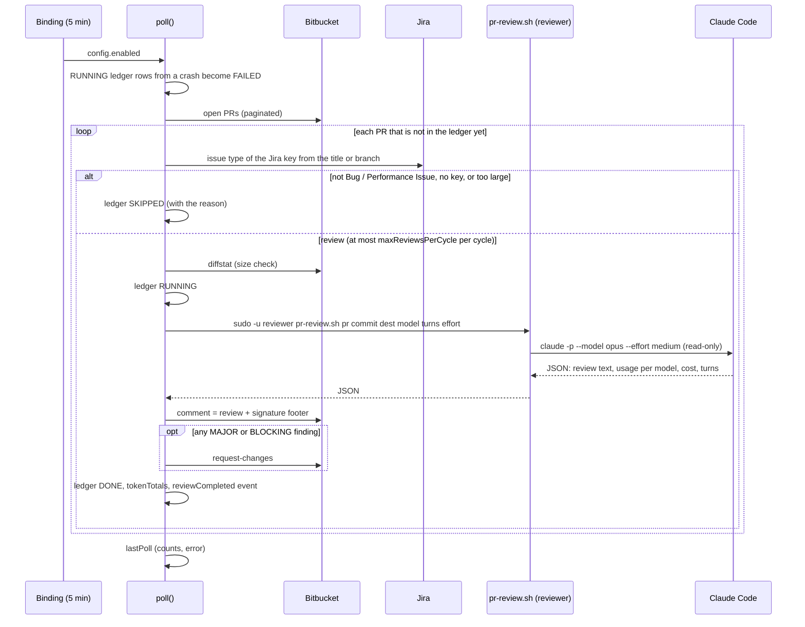

# Architecture: Claude PR Reviewer for an IoT Platform

An IoT Platform low-code model watches Bitbucket Cloud pull requests. When a pull request fixes a Jira
**Bug** or **Performance Issue** and is small or medium, the model has Claude Code review it.
It then posts the review as a pull-request comment, requests changes when a finding is MAJOR or
BLOCKING, and records the tokens and cost of every review.

## 1. Components



| Piece | Kind | Role |
|---|---|---|
| `users.admin.models.prReviewer` | Absolute model | All of the logic: 12 Java model functions, 5 variables, 1 event, 1 binding |
| `users.admin.devices.bitbucket` | HTTP device | Bitbucket Cloud API: base address and credentials (API token in the secret password field) |
| `users.admin.devices.jira` | HTTP device | Jira Cloud API: issue type and summary |
| `users.admin.dashboards.prReviewCost` | Web dashboard (grid) | Cost and token statistics |
| `/usr/local/bin/pr-review.sh` | Bash, root-owned | Prepares a throw-away git worktree and runs Claude Code |
| Linux user `reviewer` | OS account | Runs Claude Code: holds the repo clone and the Claude login, but no Bitbucket or Jira credentials |

## 2. The polling cycle

A model binding (`.:poll()`, periodic, 300 000 ms, condition `{.:config$enabled}`, queue
`prReview`) starts one cycle every 5 minutes. `poll()` is non-concurrent, so cycles never overlap.



Filtering order, from cheapest to most expensive:

1. **Duplicate check.** The PR already has a ledger row (reviewed, skipped or failed, at any commit), so it is skipped silently. Each PR is checked once; later pushes are not reviewed again. Use `reviewPr` to review it after changes.
2. **Destination.** The PR's target branch must match `destinationRegex`.
3. **Jira key.** The first key found in the title, then in the source branch. If there is none, or Jira doesn't know it, the PR is SKIPPED.
4. **Issue type.** It must be in `bugTypes` (`Bug,Performance Issue`). Otherwise the PR is SKIPPED with the type recorded.
5. **Cycle limit.** Once `maxReviewsPerCycle` reviews are done, the remaining PRs wait for the next cycle.
6. **Size.** At most `maxChangedLines` (500) and `maxChangedFiles` (20), not counting lock files, `*.d.ts` and `generated/`. Larger PRs are SKIPPED as "Too large".

**Manual trigger.** `reviewPr(prId, force)` reviews one open PR on demand, even while polling is
off. It skips the issue type and size checks, because a person chose the PR. It runs through
`poll()`, so it waits for a running cycle and the ledger still has a single writer. A commit
that was already reviewed (DONE or DRY_RUN) is refused unless `force` is true.

The `RUNNING` row is written before Claude starts. A crash therefore never leads to the same
commit being reviewed twice; the next cycle marks the row `FAILED` instead.

## 3. Model contents

### Variables

| Variable | Contents |
|---|---|
| `config` | `enabled`, `postComments`, `requestChanges`, workspace/repo, `destinationRegex`, `jiraKeyRegex`, `bugTypes`, `runAsUser`, `runnerScript`, `model`, `effort`, `maxTurns`, `timeoutMinutes`, `maxReviewsPerCycle`, `maxChangedLines`, `maxChangedFiles`, `sizeExcludeRegex` |
| `prompts` | `system`: the reviewer instructions. `task`: a template with `{prId} {title} {source} {destination} {commit} {jiraKey} {issueType} {jiraSummary} {prUrl}` |
| `ledger` | One row per PR + commit: status (`SKIPPED`/`RUNNING`/`DRY_RUN`/`DONE`/`FAILED`), Jira key, issue type, times, comment ID, reason or error |
| `tokenTotals` | Running totals of reviews, failures, tokens, cost and time; 1 year of value history |
| `lastPoll` | Result of the last cycle (kept in memory only) |

### Functions (all "Java Code" model functions)

| Function | Purpose |
|---|---|
| `poll` | One cycle (see §2); with a `prId` input, reviews only that PR |
| `reviewPr` | Manual trigger: reviews one open PR now, whatever its issue type and size, and returns its ledger row |
| `openPrs` | Open PRs of the repository |
| `issueOf` | Jira issue type and summary |
| `sizeOf` | Changed lines and files from the Bitbucket diffstat |
| `runReview` | Runs the runner script as `reviewer`, enforces the timeout, parses Claude Code's JSON result |
| `postComment` | Posts a general PR comment |
| `requestChanges` | Marks the PR "Changes requested" |
| `request` | HTTP JSON call through a device, with Basic auth sent up front (Bitbucket and Jira Cloud reply 404, not 401, to anonymous calls) |
| `usageHistory` / `usageByDay` / `usageSummary` | Read-only statistics for the dashboard |

### Event `reviewCompleted` (history kept for 1 year)

Each review produces one event with: PR, commit, Jira key and type, status, model alias and exact
model IDs, effort, changed lines and files, input / output / thinking / cache-read / cache-write
tokens, cost, turns, wall and API time, denied tool calls, Claude session ID, comment ID,
whether changes were requested, the review text, and any error.

## 4. The runner (`pr-review.sh`)

Called by the server as:
`sudo -n -u reviewer pr-review.sh <prId> <commit> <destination> <model> <maxTurns> <effort>`.

1. Validates every argument against a strict pattern, so nothing reaches a shell unchecked.
2. Reads the system prompt (base64, first line of stdin) and the task prompt (the rest of stdin).
3. Fetches into `~reviewer/repo` and resolves the commit.
4. Adds a detached worktree at the PR head. LFS downloads are skipped, since the review only reads code.
5. Runs `claude -p --output-format json --model … --effort … --max-turns …` with
   `--allowedTools Read Grep Glob "Bash(git diff:*)" "Bash(git log:*)" "Bash(git show:*)"` and
   `--disallowedTools Edit Write NotebookEdit WebFetch WebSearch`.
6. Prints Claude's JSON result and removes the worktree, even if a step fails.

## 5. Security boundaries

- **Claude holds no credentials.** It runs as `reviewer`, in a throw-away worktree, with read-only tools. It cannot edit files, reach the web or call Bitbucket.
- **Only the IoT Platform writes to Bitbucket**, with the credentials stored in the device. Comments and change requests appear as the token's owner.
- **PR content is untrusted input** and may contain prompt injection. Read-only tools limit the worst case to a misleading comment.
- **The root server switches users.** It runs one fixed, root-owned script as `reviewer` through `sudo`. The commit hash and branch are validated both in Java and in the script.

## 6. Every review comment ends with a signature

```
🤖 Automated review by the Claude Code agent — model claude-opus-5-5, effort medium
- Tokens: input 18 · output 6,234 (thinking 2,586) · cache read 347,294 · cache write 41,835 · total 395,381
- Cost $0.5289 · 10 turns · 63.3 s (API 62.3 s)
- PR size 388 lines in 7 files · commit 1a2b3c4d5e6f
```

## 7. Observed cost (first live run, 2026-10-23)

19 reviews with `claude-opus-5-5` at effort `medium`, on PRs of 45–465 changed lines:

| Metric | Value |
|---|---|
| Total cost | $8.14 |
| Average per review | $0.43 (from $0.26 to $0.78) |
| Average time | 56 s |
| Cost per 100 changed lines | about $0.22 |
| Reviews with a MAJOR finding | 9 of 19 |

For comparison, on the same PR sonnet cost about a third as much as opus ($0.18 vs $0.59). It
missed the most important finding, a real bug that opus caught and that was confirmed in the
code.

## 8. Known limits and possible next stages

- PRs from forks are not supported, because their commits are not in the main repository.
- The ledger grows forever. Rows can be deleted by hand, and deleting a row forces a re-review.
- Severity is detected by finding the text `**[MAJOR]` or `**[BLOCKING]` in the review, so the output format in the system prompt must stay as it is.
- Possible next stages: inline comments on specific lines; reviewers for other areas (security, tests) with their own prompts; a dedicated bot account; a spending cap per review (`--max-budget-usd`).
